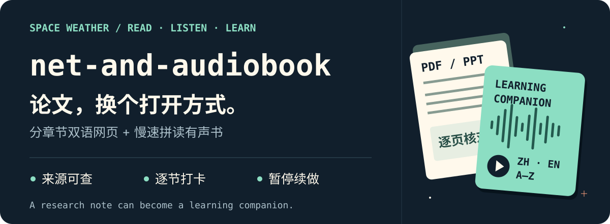
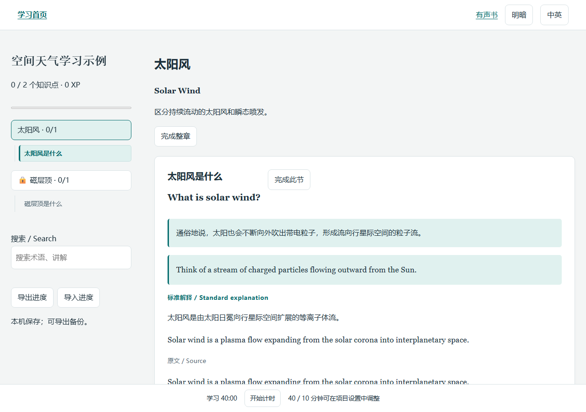
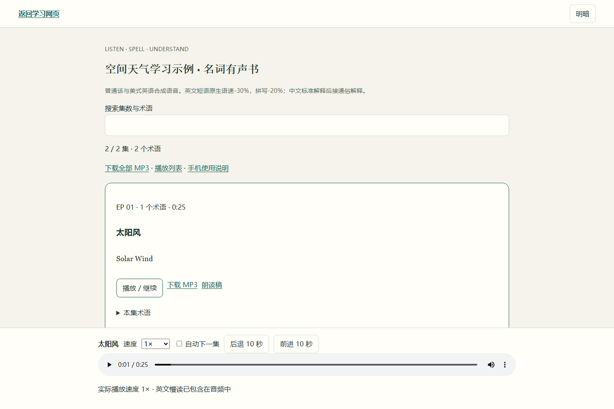
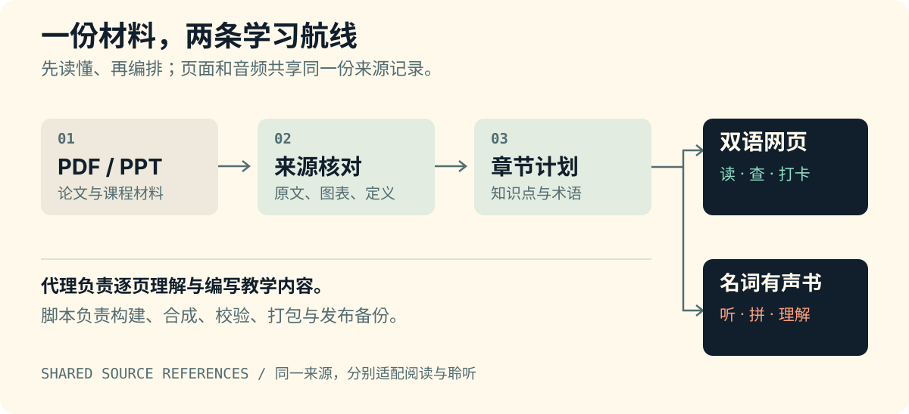

<p align="center">
  
</p>

<p align="center">
  <a href="https://github.com/siyunhao2025-beep/net_and_audiobook/actions/workflows/validate.yml"></a>
  · Python 3.10+ · 原生慢读 · 离线播放
</p>

<p align="center">
  <a href="#preview">先看成品</a> · <a href="#start">一句话开工</a> · <a href="#listen">怎么读</a> · <a href="#local">本机运行</a> · <a href="#evidence">验证记录</a>
</p>

# 空间天气网页与有声书

把空间天气、空间物理及相关论文、PDF和PPT，做成**分章节的双语学习网页**与**专业名词有声书**。来源留在网页里，英文慢读进耳机，知识点可以一节一节打卡。

> 陌生名词可以慢慢拼。学习进度，也可以慢慢攒。

<a id="preview"></a>
## 先看它长什么样

**阅读模式：** 中英讲解、通俗与标准解释、原文定位、逐节打卡、搜索和学习计时。目录列到知识点，阅读到哪一节就跟随高亮到哪一节；行内上下标和简单分式使用正式数学排版。



<details>
<summary>🎧 切换到耳机：查看有声书播放器</summary>



英文已经在合成时放慢，播放器默认 **1×**。完整网页和 MP3 保存后可以离线使用。

</details>

*以上是本仓库原创小示例的实际运行截图，含2章、2个名词。正式项目的章数与集数由材料决定。*

<a id="start"></a>
## 一句话，开工

```text
使用 $net-and-audiobook，读取我指定的论文或PPT目录，
按章节制作双语学习网页和专业名词有声书。
沿用晓晓普通话与 Jenny 美式英语，英文慢读、完整拼写；
中文标准解释后接“通俗地说，……”。
先在独立目录完成校验，再发布到我指定的位置。
```

将 [`skills/net-and-audiobook/`](skills/net-and-audiobook/) **整个目录**载入支持 `SKILL.md` 的代理环境。执行代理需要访问实际材料；远程 Windows 可使用已连接的 Desktop Commander。

入口是 [SKILL.md](skills/net-and-audiobook/SKILL.md)，完整本机步骤见 [使用指南](docs/USAGE.md)。

## 一份材料，两条学习航线



**材料 → 来源核对 → 章节计划 → 双语网页 / 名词有声书。** 代理逐页理解、翻译和编写讲解；脚本把这些内容变成可重复构建的成品。

- **在网页里学：** 知识点目录跟随、中英切换、逐节打卡、正文与图注数学排版、原图与公式核对、搜索、明暗主题、进度导入导出、40/10学习计时。
- **在耳机里记：** 主题分集、原生英语慢读、逐字母拼写、中文解释、MP3和播放列表。
- **随时停、接着做：** 请求安全暂停、缓存已完成语段、验证成品后续做；发布前备份，并检查目标文件是否被别人改动。

<a id="listen"></a>
## 耳机里的五步


**中文名词 → 英文慢读 → 完整拼写 → 中文标准解释 → “通俗地说，……”**

拼的是字母，不是手速。每个词、每个字母都保留完整发音，用停顿连接段落。

<details>
<summary>查看声线、精确语速与音频格式</summary>

| 内容 | 声线 | 原生语速 |
|---|---|---|
| 中文名词 | 晓晓普通话 | -8% |
| 英文整词、短语 | Jenny美式英语 | -30%，约0.7× |
| 完整字母拼写 | Jenny美式英语 | -20%，约0.8× |
| 中文标准解释 | 晓晓普通话 | -3% |
| “通俗地说，……” | 晓晓普通话 | -3% |

名词音频省去公式、复杂变量、PPT页码和“中文是/英文是”等标签。英语解释留在学习网页中。

成品为48kHz、单声道、128kbps MP3。语速由服务原生合成，保留字母尾音；不使用裁短字母音库或后期拉伸。自动质量检查不能替代对重音和自然度的试听。

</details>

<a id="local"></a>
## 在本机跑通小示例

准备 **Python 3.10+、ffmpeg、ffprobe**。以下为 Bash；Windows PowerShell 命令见[使用指南](docs/USAGE.md#windows-powershell)。

```bash
python -m pip install -r skills/net-and-audiobook/scripts/requirements.txt
python -m pip install playwright
python -m playwright install chromium

SKILL_DIR="$PWD/skills/net-and-audiobook"
WORK="/tmp/net-audiobook-demo"  # 选择一个新的空目录
python "$SKILL_DIR/scripts/make_demo.py" --out "$WORK/input"
python "$SKILL_DIR/scripts/build_site.py" --project "$WORK/input/project.json" \
  --sources-root "$WORK/input" --stage "$WORK/stage"
python "$SKILL_DIR/scripts/synthesize.py" build --stage "$WORK/stage"
python "$SKILL_DIR/scripts/verify.py" --stage "$WORK/stage" --audio --package
python "$SKILL_DIR/scripts/browser_check.py" --stage "$WORK/stage" --audio
```

打开 `$WORK/stage/index.html` 开始阅读，或打开 `audiobook/index.html` 聆听。**语音生成需要联网，保存后的成品可以离线播放。** PWA应用壳缓存不代表所有PDF、图片与音频已经下载。私密材料应先确认允许发送给所选TTS服务。

### 要出门？安全暂停

```bash
python "$SKILL_DIR/scripts/synthesize.py" pause --stage "$WORK/stage"
python "$SKILL_DIR/scripts/synthesize.py" status --stage "$WORK/stage"
# 确认已暂停；准备继续时：
python "$SKILL_DIR/scripts/synthesize.py" resume --stage "$WORK/stage"
```

当前有限请求会先进入缓存。恢复时核对计划指纹和音频SHA，跳过已经验证的成品。完整命令、代理与发布备份说明见[使用指南](docs/USAGE.md)。

<details>
<summary>🛰️ 科研彩蛋：一个字母，也能让人加班</summary>

**我：** 看到 W 了，是垂直风！  
**Skill：** 定义在哪一页？  
**我：** ……先翻回原文。

有些论文把 W 用作风场集合，有些地方另有约定。这里的规矩很朴素：**先查定义，证据不足就保留未定义。** 这条规则也适用于TIDI/SABER数据角色、重建与预测、GAN损失与物理约束。[查看领域规则](skills/net-and-audiobook/references/space-weather.md)。

</details>

<a id="evidence"></a>
## 有运行记录，也有适用边界

这套流程来自 **14份课程PDF、1篇风场论文、25集有声书与399个名词** 的实际项目。逐文件技术审计覆盖588个文件、69个子目录。这是来源案例的规模，后续项目按实际材料编排。

Windows的13项契约测试、HTTP/file × 桌面/手机四格浏览器检查，以及原创示例的真实语音生成、解码与打包已有记录。源材料理解、翻译、公式等价和发音自然度仍需逐项核对。

[验证记录](quality/VALIDATION.md) · [README升级检查](quality/README_REFRESH.md) · [来源审计摘要](quality/source-audit-summary.json) · [GitHub自动检查](https://github.com/siyunhao2025-beep/net_and_audiobook/actions)

默认模板在本机保存进度。云同步、原站SVG公式等扩展按项目保留并测试；升级现成网站前先记录功能基线。原文、成品录音、模型与私人配置不包含在这个仓库中。

新版阅读层及长目录检查见 [阅读界面升级说明](docs/READING_UI.md) 和 [界面检查记录](quality/READING_UI.md)。原创测试覆盖新模板、既有课程和论文三种结构；它们不能替代在实际材料上的公式核对与部署验收。

## 这次 README 用了哪些 skill

| Skill | 本次用途 |
|---|---|
| [beautify-github-readme](https://github.com/oil-oil/beautify-github-readme) | 原创矢量封面、流程图、真实截图编排与GitHub兼容检查 |
| [crafting-effective-readmes](https://github.com/softaworks/agent-toolkit/tree/main/skills/crafting-effective-readmes) | 先看成品、再上手；把进阶命令整理到独立指南 |
| [joke-engineering](https://github.com/jwynia/agent-skills/tree/main/skills/creative/humor/joke-engineering) | 精简轻松文案与科研彩蛋，保留事实和自然语气 |

这三套用于维护README，运行本项目无需额外安装它们。固定来源版本、视觉规范与可复现素材脚本见 [README设计记录](docs/README_DESIGN.md)。

